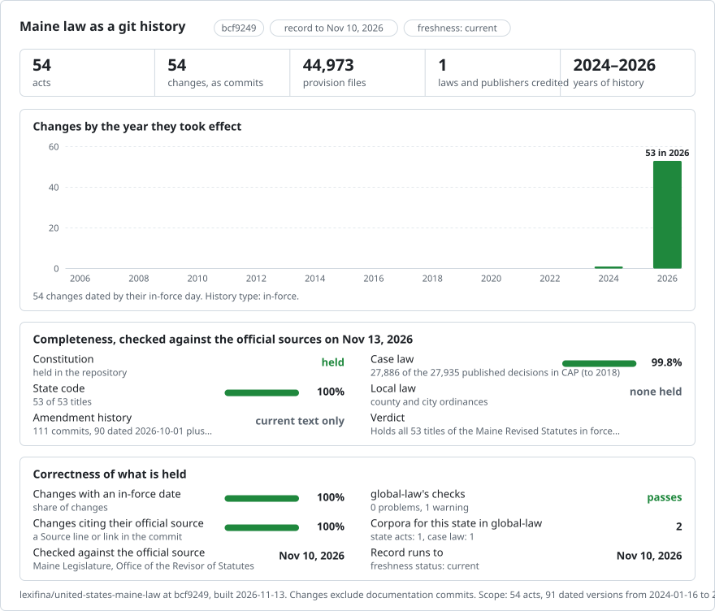

# Maine: legal texts in git

<picture>
<source media="(prefers-color-scheme: dark)" srcset="data/effort-dark.svg">

</picture>

Part of [lexifina/global-law](https://github.com/lexifina/global-law), one git history for every country's law: this is the law of Maine, United States, which global-law reads at `united-states/maine/acts/`.

The Constitution and all 53 current normative titles of the Maine Revised Statutes, published by the Maine Legislature, Office of the Revisor of Statutes.

| Folder | Act | Versions | Text |
| --- | --- | ---: | --- |
| `constitution/` | Constitution of the State of Maine (2023 arrangement) | 1 | One file per provision; source date 2024-01-16 |
| `criminal-code/` | Maine Revised Statutes, Title 17-A. Maine Criminal Code | 1 | One file per provision; source date 2026-10-01 |
| `property/` | Maine Revised Statutes, Title 33. Property | 1 | One file per provision; source date 2026-10-01 |
| `business-corporation-act/` | Maine Revised Statutes, Title 13-C. Maine Business Corporation Act | 1 | One file per provision; source date 2026-10-01 |
| `title-1-general-provisions/` | Maine Revised Statutes, Title 1. GENERAL PROVISIONS | 1 | Chapter and section files; section history retained; source date 2026-10-01 |
| `title-2-executive/` | Maine Revised Statutes, Title 2. EXECUTIVE | 1 | Chapter and section files; section history retained; source date 2026-10-01 |
| `title-3-legislature/` | Maine Revised Statutes, Title 3. LEGISLATURE | 1 | Chapter and section files; section history retained; source date 2026-10-01 |
| `title-4-judiciary/` | Maine Revised Statutes, Title 4. JUDICIARY | 1 | Chapter and section files; section history retained; source date 2026-10-01 |
| `title-5-administrative-procedures-and-services/` | Maine Revised Statutes, Title 5. ADMINISTRATIVE PROCEDURES AND SERVICES | 1 | Chapter and section files; section history retained; source date 2026-10-01 |
| `title-6-aeronautics/` | Maine Revised Statutes, Title 6. AERONAUTICS | 1 | Chapter and section files; section history retained; source date 2026-10-01 |
| `title-7-agriculture-and-animals/` | Maine Revised Statutes, Title 7. AGRICULTURE AND ANIMALS | 1 | Chapter and section files; section history retained; source date 2026-10-01 |
| `title-7-a-agriculture-conservation-and-forestry/` | Maine Revised Statutes, Title 7-A. AGRICULTURE, CONSERVATION AND FORESTRY | 1 | Chapter and section files; section history retained; source date 2026-10-01 |
| `title-8-amusements-and-sports/` | Maine Revised Statutes, Title 8. AMUSEMENTS AND SPORTS | 1 | Chapter and section files; section history retained; source date 2026-10-01 |
| `title-9-banks-and-financial-institutions/` | Maine Revised Statutes, Title 9. BANKS AND FINANCIAL INSTITUTIONS | 1 | Chapter and section files; section history retained; source date 2026-10-01 |
| `title-9-a-maine-consumer-credit-code/` | Maine Revised Statutes, Title 9-A. MAINE CONSUMER CREDIT CODE | 1 | Section files, including native Word formula text; source date 2026-10-01 |
| `title-9-b-financial-institutions/` | Maine Revised Statutes, Title 9-B. FINANCIAL INSTITUTIONS | 1 | Chapter and section files; section history retained; source date 2026-10-01 |
| `title-10-commerce-and-trade/` | Maine Revised Statutes, Title 10. COMMERCE AND TRADE | 1 | Chapter and section files; section history retained; source date 2026-10-01 |
| `title-11-uniform-commercial-code/` | Maine Revised Statutes, Title 11. UNIFORM COMMERCIAL CODE | 1 | Chapter and section files; section history retained; source date 2026-10-01 |
| `title-12-conservation/` | Maine Revised Statutes, Title 12. CONSERVATION | 1 | Chapter and section files; section history retained; source date 2026-10-01 |
| `title-13-corporations/` | Maine Revised Statutes, Title 13. CORPORATIONS | 1 | Chapter and section files; section history retained; source date 2026-10-01 |
| `title-13-b-maine-nonprofit-corporation-act/` | Maine Revised Statutes, Title 13-B. MAINE NONPROFIT CORPORATION ACT | 1 | Chapter and section files; section history retained; source date 2026-10-01 |
| `title-14-court-procedure-civil/` | Maine Revised Statutes, Title 14. COURT PROCEDURE -- CIVIL | 1 | Chapter and section files; section history retained; source date 2026-10-01 |
| `title-15-court-procedure-criminal/` | Maine Revised Statutes, Title 15. COURT PROCEDURE -- CRIMINAL | 1 | Chapter and section files; section history retained; source date 2026-10-01 |
| `title-16-court-procedure-evidence/` | Maine Revised Statutes, Title 16. COURT PROCEDURE -- EVIDENCE | 1 | Chapter and section files; section history retained; source date 2026-10-01 |
| `title-17-crimes/` | Maine Revised Statutes, Title 17. CRIMES | 1 | Chapter and section files; section history retained; source date 2026-10-01 |
| `title-18-decedents-estates-and-fiduciary-relation/` | Maine Revised Statutes, Title 18. DECEDENTS' ESTATES AND FIDUCIARY RELATIONS | 1 | Chapter and section files; section history retained; source date 2026-10-01 |
| `title-18-b-trusts/` | Maine Revised Statutes, Title 18-B. TRUSTS | 1 | Chapter and section files; section history retained; source date 2026-10-01 |
| `title-18-c-probate-code/` | Maine Revised Statutes, Title 18-C. PROBATE CODE | 1 | Chapter and section files; section history retained; source date 2026-10-01 |
| `title-19-a-domestic-relations/` | Maine Revised Statutes, Title 19-A. DOMESTIC RELATIONS | 1 | Chapter and section files; section history retained; source date 2026-10-01 |
| `title-20-education/` | Maine Revised Statutes, Title 20. EDUCATION | 1 | Chapter and section files; section history retained; source date 2026-10-01 |
| `title-20-a-education/` | Maine Revised Statutes, Title 20-A. EDUCATION | 1 | Chapter and section files; section history retained; source date 2026-10-01 |
| `title-21-a-elections/` | Maine Revised Statutes, Title 21-A. ELECTIONS | 1 | Chapter and section files; section history retained; source date 2026-10-01 |
| `title-22-health-and-welfare/` | Maine Revised Statutes, Title 22. HEALTH AND WELFARE | 1 | Chapter and section files; section history retained; source date 2026-10-01 |
| `title-22-a-health-and-human-services/` | Maine Revised Statutes, Title 22-A. HEALTH AND HUMAN SERVICES | 1 | Chapter and section files; section history retained; source date 2026-10-01 |
| `title-23-transportation/` | Maine Revised Statutes, Title 23. TRANSPORTATION | 1 | Chapter and section files; section history retained; source date 2026-10-01 |
| `title-24-insurance/` | Maine Revised Statutes, Title 24. INSURANCE | 1 | Chapter and section files; section history retained; source date 2026-10-01 |
| `title-24-a-maine-insurance-code/` | Maine Revised Statutes, Title 24-A. MAINE INSURANCE CODE | 1 | Chapter and section files; section history retained; source date 2026-10-01 |
| `title-25-internal-security-and-public-safety/` | Maine Revised Statutes, Title 25. INTERNAL SECURITY AND PUBLIC SAFETY | 1 | Chapter and section files; section history retained; source date 2026-10-01 |
| `title-26-labor-and-industry/` | Maine Revised Statutes, Title 26. LABOR AND INDUSTRY | 1 | Chapter and section files; section history retained; source date 2026-10-01 |
| `title-27-libraries-history-culture-and-art/` | Maine Revised Statutes, Title 27. LIBRARIES, HISTORY, CULTURE AND ART | 1 | Chapter and section files; section history retained; source date 2026-10-01 |
| `title-28-a-liquors/` | Maine Revised Statutes, Title 28-A. LIQUORS | 1 | Chapter and section files; section history retained; source date 2026-10-01 |
| `title-28-b-cannabis/` | Maine Revised Statutes, Title 28-B. CANNABIS | 1 | Chapter and section files; section history retained; source date 2026-10-01 |
| `title-29-a-motor-vehicles-and-traffic/` | Maine Revised Statutes, Title 29-A. MOTOR VEHICLES AND TRAFFIC | 1 | Section files, including native Word formula text; source date 2026-10-01 |
| `title-30-federally-recognized-indian-tribes/` | Maine Revised Statutes, Title 30. FEDERALLY RECOGNIZED INDIAN TRIBES | 1 | Chapter and section files; section history retained; source date 2026-10-01 |
| `title-30-a-municipalities-and-counties/` | Maine Revised Statutes, Title 30-A. MUNICIPALITIES AND COUNTIES | 1 | Chapter and section files; section history retained; source date 2026-10-01 |
| `title-31-partnerships-and-associations/` | Maine Revised Statutes, Title 31. PARTNERSHIPS AND ASSOCIATIONS | 1 | Chapter and section files; section history retained; source date 2026-10-01 |
| `title-32-professions-and-occupations/` | Maine Revised Statutes, Title 32. PROFESSIONS AND OCCUPATIONS | 1 | Chapter and section files; section history retained; source date 2026-10-01 |
| `title-34-a-corrections/` | Maine Revised Statutes, Title 34-A. CORRECTIONS | 1 | Chapter and section files; section history retained; source date 2026-10-01 |
| `title-34-b-behavioral-and-developmental-services/` | Maine Revised Statutes, Title 34-B. BEHAVIORAL AND DEVELOPMENTAL SERVICES | 1 | Chapter and section files; section history retained; source date 2026-10-01 |
| `title-35-a-public-utilities/` | Maine Revised Statutes, Title 35-A. PUBLIC UTILITIES | 1 | Chapter and section files; section history retained; source date 2026-10-01 |
| `title-36-taxation/` | Maine Revised Statutes, Title 36. TAXATION | 1 | Chapter and section files; section history retained; source date 2026-10-01 |
| `title-37-b-defense-veterans-and-emergency-managemen/` | Maine Revised Statutes, Title 37-B. DEFENSE, VETERANS AND EMERGENCY MANAGEMENT | 1 | Chapter and section files; section history retained; source date 2026-10-01 |
| `title-38-waters-and-navigation/` | Maine Revised Statutes, Title 38. WATERS AND NAVIGATION | 1 | Chapter and section files; section history retained; source date 2026-10-01 |
| `title-39-a-workers-compensation/` | Maine Revised Statutes, Title 39-A. WORKERS' COMPENSATION | 1 | Chapter and section files; section history retained; source date 2026-10-01 |

Session laws as enacted:

| Folder | Act | Versions | Text |
| --- | --- | ---: | --- |
| `public-law-2025-chapter-0001/` | An Act to Eliminate the Provision of the Maine Workers' Compensation Act of 1992 That Allows an Employer Member of a Group Self-insurer to Insure Its Employees Through a Fronting Arrangement | 1 | Session law as enacted; effective 2025-06-20 |
| `public-law-2025-chapter-0004/` | An Act to Designate the Warden of the Maine State Prison as Chief Administrative Officer of the Bolduc Correctional Facility | 1 | Session law as enacted; effective 2025-06-20 |
| `public-law-2025-chapter-0005/` | An Act to Revitalize the Maine Temporary Assistance for Needy Families Advisory Council | 1 | Session law as enacted; effective 2025-06-20 |
| `public-law-2025-chapter-0011/` | An Act to Reorganize and Simplify Certain Exceptions in the Use Regulation Law | 1 | Session law as enacted; effective 2025-06-20 |
| `public-law-2025-chapter-0012/` | An Act to Create Consistency in Retirement Service Benefits Deferral Under the Maine Public Employees Retirement System | 1 | Session law as enacted; effective 2025-06-20 |
| `public-law-2025-chapter-0013/` | An Act to Rename the Administrator of the Office of Chief Medical Examiner the Director of Medical Examiner Operations | 1 | Session law as enacted; effective 2025-06-20 |
| `public-law-2025-chapter-0014/` | An Act Regarding the Disposal of Abandoned Human Remains | 1 | Session law as enacted; effective 2025-06-20 |
| `public-law-2025-chapter-0015/` | An Act to Update the Laws Governing the Administration of the Animal Welfare Advisory Council | 1 | Session law as enacted; effective 2025-06-20 |
| `public-law-2025-chapter-0016/` | An Act to Change the Size and Composition of the Board of Directors of the Maine Health Data Organization | 1 | Session law as enacted; effective 2025-06-20 |
| `public-law-2025-chapter-0017/` | An Act to Protect Federal Home Loan Banks That Lend Money to Insurer Members That Become Delinquent | 1 | Session law as enacted; effective 2025-06-20 |
| `public-law-2025-chapter-0020/` | An Act to Amend the Procedure for Filing a Petition to Terminate Parental Rights and Responsibilities | 1 | Session law as enacted; effective 2025-09-24 |
| `public-law-2025-chapter-0021/` | An Act to Clarify the Law Governing the Minimum Indirect Financial Interest Disclosure Requirement for Liquor Licenses | 1 | Session law as enacted; effective 2025-09-24 |
| `public-law-2025-chapter-0024/` | An Act to Designate November as Pancreatic Cancer Awareness Month | 1 | Session law as enacted; effective 2025-09-24 |
| `public-law-2025-chapter-0025/` | An Act to Increase the Expenditure Limit for the Informal Bidding Process for the Selection of Professional, Architect and Engineer Services | 1 | Session law as enacted; effective 2025-09-24 |
| `public-law-2025-chapter-0026/` | An Act to Update the System of Learning Results Review Timeline | 1 | Session law as enacted; effective 2025-09-24 |
| `public-law-2025-chapter-0029/` | An Act to Amend the Laws Governing the Commercial Large Game Shooting Area License Transfer Process | 1 | Session law as enacted; effective 2025-09-24 |
| `public-law-2025-chapter-0030/` | An Act to Establish the Respite for ME Program | 1 | Session law as enacted; effective 2025-09-24 |
| `public-law-2025-chapter-0035/` | An Act to Protect Maine Consumers by Prohibiting Fees Charged for Receiving Paper Statements from Financial Institutions and Credit Card Issuers | 1 | Session law as enacted; effective 2025-09-24 |
| `public-law-2025-chapter-0038/` | An Act to Expand Municipal Authority over Utility Pole Permits | 1 | Session law as enacted; effective 2025-09-24 |
| `public-law-2025-chapter-0039/` | An Act to Update the Solar Energy Development Reporting Date Deadline | 1 | Session law as enacted; effective 2025-09-24 |
| `public-law-2025-chapter-0042/` | An Act to Eliminate Miscarriage Reporting Requirements | 1 | Session law as enacted; effective 2025-09-24 |
| `public-law-2025-chapter-0043/` | An Act to Repeal the Sunday Amateur Sports Law, the Law Allowing Municipalities to Permit the Operation of Movie Theaters on Sundays and the Law Imposing a Fine or Imprisonment for Playing Games and Sports with Admission Charges on Memorial Day | 1 | Session law as enacted; effective 2025-09-24 |
| `public-law-2025-chapter-0045/` | An Act to Use Certain Regional Transmission Organization Payments for Beneficial Electrification to Reduce Electricity Rates | 1 | Session law as enacted; effective 2025-09-24 |
| `public-law-2025-chapter-0046/` | An Act to Ensure That the Exemption of Certain Agricultural Buildings from the Maine Uniform Building and Energy Code Includes Maple Sugarhouses | 1 | Session law as enacted; effective 2025-09-24 |
| `public-law-2025-chapter-0048/` | An Act to Amend the Membership of the State Employee Health Commission and Make Referential Changes to the Office of Employee Health, Wellness and Workers' Compensation | 1 | Session law as enacted; effective 2025-09-24 |
| `public-law-2025-chapter-0049/` | An Act to Allow for Rescission of a Site Location of Development Permit When a Development Is Decommissioned | 1 | Session law as enacted; effective 2025-09-24 |
| `public-law-2025-chapter-0050/` | An Act to Clarify the Process to Transfer Funds Resulting from the Expiration of Unused Kilowatt-hour Credits to Be Used to Provide Assistance to Low-income Electricity Customers | 1 | Session law as enacted; effective 2025-09-24 |
| `public-law-2025-chapter-0052/` | An Act to Clarify Processes of the Board of Environmental Protection | 1 | Session law as enacted; effective 2025-09-24 |
| `public-law-2025-chapter-0054/` | An Act to Align the Schedules for Climate Change Protection Plans and Grid-enhancing Technology Reviews with the Integrated Grid Planning Process | 1 | Session law as enacted; effective 2025-09-24 |
| `public-law-2025-chapter-0057/` | An Act to Expand the Use of the Veterans' Homelessness Prevention Partnership Fund | 1 | Session law as enacted; effective 2025-09-24 |
| `public-law-2025-chapter-0058/` | An Act to Include School Counselors in the Educators for Maine Program | 1 | Session law as enacted; effective 2025-09-24 |
| `public-law-2025-chapter-0059/` | An Act to Establish Immunity for a Receiver Appointed by the Public Utilities Commission to Oversee the Operations of a Consumer-owned Water Utility | 1 | Session law as enacted; effective 2025-09-24 |
| `public-law-2025-chapter-0063/` | An Act to Require Reporting of Sheltering or Aiding Missing Children | 1 | Session law as enacted; effective 2025-09-24 |
| `public-law-2025-chapter-0064/` | An Act to Allow Persons to Label Their Wild Animal Traps with Their Online Identification Number Issued by the Department of Inland Fisheries and Wildlife | 1 | Session law as enacted; effective 2025-09-24 |
| `public-law-2025-chapter-0065/` | An Act to Establish the PFAS Response Program and to Modify the Fund To Address PFAS Contamination | 1 | Session law as enacted; effective 2025-09-24 |
| `public-law-2025-chapter-0066/` | An Act to Amend the Transportation Laws | 1 | Session law as enacted; effective 2025-09-24 |
| `public-law-2025-chapter-0067/` | An Act Clarifying Exemptions from the Law Regulating Products Containing PFAS | 1 | Session law as enacted; effective 2025-09-24 |
| `public-law-2025-chapter-0068/` | An Act to Change in Statute the Areas Represented by the Members of the Board of Trustees of the Cross Insurance Arena from Sets of Municipalities to the County Commissioner Districts of Cumberland County | 1 | Session law as enacted; effective 2025-09-24 |
| `public-law-2025-chapter-0073/` | An Act Regarding Information That May Be Shared by Law Enforcement Entities with a School Superintendent or a Principal | 1 | Session law as enacted; effective 2025-09-24 |
| `public-law-2025-chapter-0074/` | An Act Regarding the Confidentiality of Certain Lottery Winner Identities | 1 | Session law as enacted; effective 2025-09-24 |
| `public-law-2025-chapter-0075/` | An Act to Support Municipal Public Health | 1 | Session law as enacted; effective 2025-09-24 |
| `public-law-2025-chapter-0076/` | An Act to Clarify the Maximum Value That a Small Estate May Be Under the Maine Uniform Probate Code to Permit Collection of Personal Property by Affidavit | 1 | Session law as enacted; effective 2025-09-24 |
| `public-law-2025-chapter-0077/` | An Act to Expand the Definition of "Terrorism" in the Laws Governing the Maine Emergency Management Agency | 1 | Session law as enacted; effective 2025-09-24 |
| `public-law-2025-chapter-0078/` | An Act Regarding School Enrollment for Military-connected Students | 1 | Session law as enacted; effective 2025-09-24 |
| `public-law-2025-chapter-0079/` | An Act to Require Reporting on the Expenditure of Opioid Settlement Funds by Certain Municipalities and County Governments | 1 | Session law as enacted; effective 2025-09-24 |
| `public-law-2025-chapter-0080/` | An Act to Provide Limited Immunity to Maine Human Rights Commission Mediators | 1 | Session law as enacted; effective 2025-09-24 |
| `public-law-2025-chapter-0088/` | An Act to Exempt a Person Making Electrical Installations in the Person's Existing Bona Fide Personal Abode from Licensing and Permitting Requirements | 1 | Session law as enacted; effective 2025-09-24 |
| `public-law-2025-chapter-0089/` | An Act Regarding Reciprocal Licensure for Professional Engineers | 1 | Session law as enacted; effective 2025-09-24 |
| `public-law-2025-chapter-0090/` | An Act Regarding the Use of Military Protective Orders in Protection from Abuse and Protection from Harassment Proceedings | 1 | Session law as enacted; effective 2025-09-24 |
| `public-law-2025-chapter-0091/` | An Act to Clarify Performance Standards for Quarries | 1 | Session law as enacted; effective 2025-09-24 |
| `public-law-2025-chapter-0092/` | An Act to Ensure Rent-to-own Protections Apply to Mobile Home Park Tenants | 1 | Session law as enacted; effective 2025-09-24 |
| `public-law-2025-chapter-0094/` | An Act to Add an Inflation Adjustment to the Maximum Amount of Funding Disbursed from the Maine Ground and Surface Waters Clean-up and Response Fund for Certain Personal Services of the Department of Environmental Protection | 1 | Session law as enacted; effective 2025-09-24 |
| `public-law-2025-chapter-0095/` | An Act to Amend the Laws Governing Fantasy Contests | 1 | Session law as enacted; effective 2025-09-24 |
| `public-law-2025-chapter-0098/` | An Act to Establish Certain Positions Within the Maine Bureau of Veterans' Services | 1 | Session law as enacted; effective 2025-09-24 |
| `public-law-2025-chapter-0100/` | An Act to Allow County Commissioners Greater Flexibility When Establishing a Payment Schedule for Municipalities to Pay County Tax Bills | 1 | Session law as enacted; effective 2025-09-24 |
| `public-law-2025-chapter-0101/` | An Act to Provide Access to Quality Family Child Care for Military Personnel by Exempting Certain Military Child Care Providers from State Licensing Requirements | 1 | Session law as enacted; effective 2025-09-24 |
| `public-law-2025-chapter-0102/` | An Act to Strengthen the Requirements for Medical Payments Coverage | 1 | Session law as enacted; effective 2025-09-24 |
| `public-law-2025-chapter-0103/` | An Act to Amend the Law Governing Zoning Ordinance Variances for Persons with Permanent Disabilities | 1 | Session law as enacted; effective 2025-09-24 |
| `public-law-2025-chapter-0104/` | An Act Regarding Service of Notice of Restricted Person Status to Hospitalized Patients | 1 | Session law as enacted; effective 2025-09-24 |
| `public-law-2025-chapter-0105/` | An Act to Advance Energy Storage Within the State | 1 | Session law as enacted; effective 2025-09-24 |
| `public-law-2025-chapter-0106/` | An Act to Amend the Site Location of Development Laws to Require a 100-foot Buffer Between Solar Energy Developments and Rivers, Streams and Brooks | 1 | Session law as enacted; effective 2025-09-24 |
| `public-law-2025-chapter-0107/` | An Act to Align Intrastate Commercial Motor Vehicle Insurance Requirements with Federal Standards | 1 | Session law as enacted; effective 2025-09-24 |
| `public-law-2025-chapter-0108/` | An Act to Extend the Time Frame for a Chiropractic Intern License | 1 | Session law as enacted; effective 2025-09-24 |
| `public-law-2025-chapter-0109/` | An Act to Remove the Term "Alleged" When Referring to Victims of Sexual Assault in the Provisions of the Maine Revised Statutes Pertaining to Forensic Examinations | 1 | Session law as enacted; effective 2025-09-24 |
| `public-law-2025-chapter-0111/` | An Act to Implement the Recommendations of the Right to Know Advisory Committee Concerning Public Records Exceptions | 1 | Session law as enacted; effective 2025-09-24 |
| `public-law-2025-chapter-0114/` | An Act to Initiate Recounts in Tied Elections | 1 | Session law as enacted; effective 2025-09-24 |

| `public-law-2025-chapter-0124/` | An Act Regarding the Term of Appointment of Judicial Officers | 1 | Session law as enacted; effective 2025-09-24 |
| `public-law-2025-chapter-0125/` | An Act to Update the Provision of Law Concerning Student Codes of Conduct in Order to Reflect Best Practices Regarding Behavioral Threat Assessment and Response | 1 | Session law as enacted; effective 2025-09-24 |
| `public-law-2025-chapter-0126/` | An Act to Amend and Simplify Certain Inland Fisheries and Wildlife Licensing and Permitting Laws | 1 | Session law as enacted; effective 2025-09-24 |
| `public-law-2025-chapter-0128/` | An Act to Update the Definition of "Coastal Wetlands" Under the Natural Resources Protection Act and the Mandatory Shoreland Zoning Laws | 1 | Session law as enacted; effective 2025-09-24 |
| `public-law-2025-chapter-0129/` | An Act to Establish Minimum Standards for Certain Urgent Care Facilities | 1 | Session law as enacted; effective 2025-09-24 |
| `public-law-2025-chapter-0130/` | An Act Concerning the Filing of Marriage Licenses and the Recording of Intentions as Part of the Electronic Vital Records System | 1 | Session law as enacted; effective 2025-09-24 |
| `public-law-2025-chapter-0131/` | An Act to Authorize the Release of Military Records to the Office of Chief Medical Examiner for the Purposes of Suicide Reporting and Prevention | 1 | Session law as enacted; effective 2025-09-24 |
| `public-law-2025-chapter-0133/` | An Act to Establish a Date to Begin Voting by Absentee Ballot in the Presence of the Clerk | 1 | Session law as enacted; effective 2025-09-24 |
| `public-law-2025-chapter-0135/` | An Act to Increase the Number of Children a Child Care Provider May Care for Without Having to Be Licensed by the Department of Health and Human Services | 1 | Session law as enacted; effective 2025-09-24 |
| `public-law-2025-chapter-0136/` | An Act to Allow Retail Pharmacies to Operate Remote Dispensing Sites in Rural Areas | 1 | Session law as enacted; effective 2025-09-24 |
| `public-law-2025-chapter-0137/` | An Act to Authorize the Public Utilities Commission to Approve Rate Adjustments for Low-income Water Utility Ratepayers | 1 | Session law as enacted; effective 2025-09-24 |
| `public-law-2025-chapter-0138/` | An Act to Prohibit the Sale of Self-administered Sexual Assault Forensic Evidence Collection Kits | 1 | Session law as enacted; effective 2025-09-24 |
| `public-law-2025-chapter-0139/` | An Act Regarding the Domestic Violence Advocate Privilege | 1 | Session law as enacted; effective 2025-09-24 |
| `public-law-2025-chapter-0140/` | An Act Regarding the Substance Use Disorder Services Commission | 1 | Session law as enacted; effective 2025-09-24 |
| `public-law-2025-chapter-0142/` | An Act to Amend Maine's Prescription Drug Labeling Law by Allowing the Removal of the Name of a Prescriber of Mifepristone, Misoprostol and Their Generic Alternatives | 1 | Session law as enacted; effective 2025-09-24 |
| `public-law-2025-chapter-0143/` | An Act to Allow the Secretary of State to Collect Excise Taxes on Motor Vehicles Owned by Residents Who Are Unhoused | 1 | Session law as enacted; effective 2025-09-24 |
| `public-law-2025-chapter-0144/` | An Act to Designate January 6th as A Day to Remember | 1 | Session law as enacted; effective 2025-09-24 |
| `public-law-2025-chapter-0154/` | An Act Regarding the State Workforce Board | 1 | Session law as enacted; effective 2025-09-24 |
| `public-law-2025-chapter-0157/` | An Act to Allow a Motion to Extend a Protection from Abuse Order After Expiration of the Original Order | 1 | Session law as enacted; effective 2025-09-24 |
| `public-law-2025-chapter-0158/` | An Act to Increase Access to Protection from Abuse Orders by Allowing Children to File Protection from Abuse Orders on Their Own Behalf | 1 | Session law as enacted; effective 2025-09-24 |
| `public-law-2025-chapter-0159/` | An Act to Clarify Standards for Defendants' Post-judgment Motions for Relief from Protection from Abuse Orders | 1 | Session law as enacted; effective 2025-09-24 |
| `public-law-2025-chapter-0161/` | An Act Regarding Apportionment of Stipends to Agricultural Fairs | 1 | Session law as enacted; effective 2025-09-24 |
| `public-law-2025-chapter-0162/` | An Act to Establish the Municipal Stream Crossing Fund | 1 | Session law as enacted; effective 2025-09-24 |
| `public-law-2025-chapter-0163/` | An Act to Preserve Traditional Driver's Licenses and Nondriver Identification Cards | 1 | Session law as enacted; effective 2025-09-24 |
| `public-law-2025-chapter-0164/` | An Act to Update the Maine Self-service Storage Act | 1 | Session law as enacted; effective 2025-09-24 |
| `public-law-2025-chapter-0165/` | An Act to Modify the Laws Regarding Driver's License Applications | 1 | Session law as enacted; effective 2025-09-24 |
| `public-law-2025-chapter-0166/` | An Act to Amend Laws Governing Hearing Aid Dealers to Allow an Exception to Certain Hearing Examination Requirements | 1 | Session law as enacted; effective 2025-09-24 |
| `public-law-2025-chapter-0169/` | An Act to Create a Green Crab Only Wholesale Dealer License | 1 | Session law as enacted; effective 2025-09-24 |
| `public-law-2025-chapter-0170/` | An Act to Promote Firewood Banks in Maine | 1 | Session law as enacted; effective 2025-09-24 |
| `public-law-2025-chapter-0171/` | An Act to Provide Relocation Assistance to Crime Victims | 1 | Session law as enacted; effective 2025-09-24 |
| `public-law-2025-chapter-0173/` | An Act to Eliminate Requirements for Drivers to Surrender Their Physical Driver's Licenses During a Temporary Suspension | 1 | Session law as enacted; effective 2025-09-24 |
| `public-law-2025-chapter-0174/` | An Act to Allow the Keeping of Chickens on Private Residential Property | 1 | Session law as enacted; effective 2025-09-24 |
| `public-law-2025-chapter-0175/` | An Act to Implement the Recommendations of the Right to Know Advisory Committee Concerning Public Records Requests | 1 | Session law as enacted; effective 2025-09-24 |
| `public-law-2025-chapter-0192/` | An Act to Expand Access to the Maine Wage Assurance Fund | 1 | Session law as enacted; effective 2025-09-24 |
| `public-law-2025-chapter-0193/` | An Act Regarding Penalties for Violating the Maine Weights and Measures Law | 1 | Session law as enacted; effective 2025-09-24 |
| `public-law-2025-chapter-0197/` | An Act to Extend the Maximum Time Period for Certain School Construction Bonds | 1 | Session law as enacted; effective 2025-09-24 |
| `public-law-2025-chapter-0198/` | An Act to Allow the Public Utilities Commission to Use Quantitative Metrics and Rate-adjustment Mechanisms in a Proceeding for a General Rate Increase | 1 | Session law as enacted; effective 2025-09-24 |
| `public-law-2025-chapter-0199/` | An Act Regarding the Rates of Speed at Which School Buses Travel | 1 | Session law as enacted; effective 2025-09-24 |
| `public-law-2025-chapter-0201/` | An Act to Strengthen Consumer Protections by Prohibiting the Report of Medical Debt on Consumer Reports | 1 | Session law as enacted; effective 2025-09-24 |
| `public-law-2025-chapter-0202/` | An Act to Promote Public Safety and Retain Essential First Responders by Converting the Maine Length of Service Award Program Trust Fund to a Nonlapsing Fund | 1 | Session law as enacted; effective 2025-09-24 |
| `public-law-2025-chapter-0203/` | An Act Regarding Pre-need Funeral Insurance | 1 | Session law as enacted; effective 2025-09-24 |
| `public-law-2025-chapter-0204/` | An Act to Increase the Maximum Cash Prize for the Long Lake Ice Fishing Derby | 1 | Session law as enacted; effective 2025-09-24 |
| `public-law-2025-chapter-0205/` | An Act to Amend the Law Regarding the Checking of Baitfish Traps | 1 | Session law as enacted; effective 2025-09-24 |
| `public-law-2025-chapter-0207/` | An Act to Remove the Limit on the Length of Probation That May Be Served for Aggravated Attempted Murder | 1 | Session law as enacted; effective 2025-09-24 |
| `public-law-2025-chapter-0208/` | An Act Regarding Unallocated Balances in a School Administrative Unit School Budget | 1 | Session law as enacted; effective 2025-09-24 |
| `public-law-2025-chapter-0209/` | An Act to Prohibit Governmental Entities That Charge a Fee for In-person Credit Card Purchases from Refusing to Accept Cash | 1 | Session law as enacted; effective 2025-09-24 |
| `public-law-2025-chapter-0210/` | An Act Regarding Cellular Telephones in Public Schools | 1 | Session law as enacted; effective 2025-09-24 |
| `public-law-2025-chapter-0211/` | An Act to Update the Laws Regarding Athletic Trainers | 1 | Session law as enacted; effective 2025-09-24 |
| `public-law-2025-chapter-0212/` | An Act Regarding the Number of Voters of a Municipality Required to Petition for Consideration of Deorganization of That Municipality | 1 | Session law as enacted; effective 2025-09-24 |
| `public-law-2025-chapter-0214/` | An Act to Increase Contingency Reserves for Maine's Consumer-owned Electric Transmission and Distribution Utilities | 1 | Session law as enacted; effective 2025-09-24 |
| `public-law-2025-chapter-0216/` | An Act Regarding the Voluntary Municipal Farm Support Program | 1 | Session law as enacted; effective 2025-09-24 |
| `public-law-2025-chapter-0217/` | An Act to Require Gas Utilities to Assess for Natural Gas Leaks and to Require Reporting of Gas Leak Information | 1 | Session law as enacted; effective 2025-09-24 |
| `public-law-2025-chapter-0218/` | An Act to Amend the Laws Governing Primary Care Reporting by the Maine Quality Forum and to Establish the Primary Care Advisory Council | 1 | Session law as enacted; effective 2025-09-24 |
| `public-law-2025-chapter-0219/` | An Act to Require Law Enforcement Agencies to Adopt Written Policies Regarding Compliance with Certain Constitutional Obligations Related to Disclosure of Evidence | 1 | Session law as enacted; effective 2025-09-24 |

The statutory titles retain the complete official wording, including chapter headings, section-history notes and repeal placeholders. Titles 9-A and 29-A use section files containing native Word formula text; the other titles use chapter and section files or their original provision files.

The statutory source says its text is current through 1 October 2026. This is the consolidation date of each baseline, not the commencement of every provision. The Constitution retains its existing source-date record. Earlier consolidated versions are not added in this batch.

Wholly repealed titles with no current normative section are excluded. The record also contains 120 selected 2025 public laws as enacted, with approval and effective dates supplied by the official sources. These enactments are separate from the consolidated titles and do not reconstruct their earlier wording. The record does not cover all session laws or administrative rules.

Official source: <https://legislature.maine.gov/statutes/>. Constitution: <https://legislature.maine.gov/doc/10674>.

The Revisor requires republications to include this disclaimer:

> All copyrights and other rights to statutory text are reserved by the State of Maine. The text included in this publication reflects changes made through the Second Regular Session of the 132nd Maine Legislature and is current through October 1, 2026. The text is subject to change without notice. It is a version that has not been officially certified by the Secretary of State. Refer to the Maine Revised Statutes Annotated and supplements for certified text.

The Office of the Revisor requests one copy of any statutory publication. This repository is not an official publication or legal advice.
